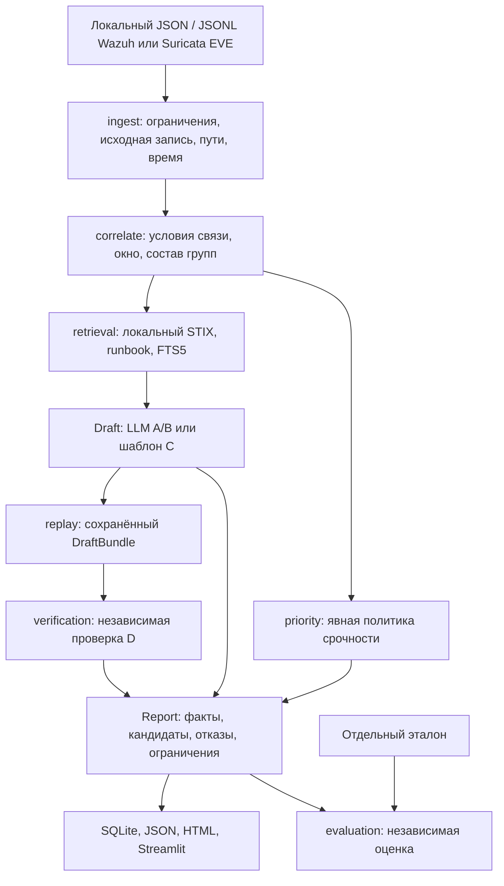

# Архитектура и поток данных (глава 2)

Версия приложения 0.2.0, схема результата 1.2. Один локальный пользователь,
одна задача анализа, CPU, файловые экспорты, Streamlit на 127.0.0.1.
Ассистент формирует предварительный отчёт. Решение и запрос контекста выполняет аналитик.

## Границы модулей

| Модуль | Ответственность и результат |
|---|---|
| `ingest.py` | Ограниченный импорт UTF-8 JSON, массива и JSONL; Wazuh `rule.id`/`agent.id`; EVE `event_type`. Сохраняет `raw`, источник, ID записи, исходные значения, RFC 6901 JSON Pointer и SHA-256 файла. |
| `evidence.py` | Разрешение указателя, строгое равенство типов и значений, канонические хеши. Не является семантическим оценщиком. |
| `correlate.py` | Ограниченные случаи по узлу и общей сущности либо sensor/flow_id. Окно 600 с по умолчанию ограничивает весь случай. Все основания и все происхождения повторов сохраняются. |
| `retrieval.py` | STIX Enterprise ATT&CK, FTS5/BM25, версия индекса, версия документа, точный текст и полуинтервал `[start_char,end_char)` в Unicode-символах. |
| `generation.py` | Один локальный GGUF через CPU llama-cpp-python; строгая грамматика Draft; нет инструментов исполнения. Режим A не получает справочные фрагменты. |
| `profiles.py` | Три версии условий Sysmon Process Create. Генерирует кандидаты C; D отдельно проверяет заявленные выводы. |
| `verification.py` | Без LLM проверяет сохранённый черновик, исходные поля, идентичность ATT&CK, наблюдения, ссылки, связи, хронологию, приоритет и применимость двух типов рекомендаций. |
| `priority.py` | Срочность high/medium/low/unknown по явным признакам и локальному справочнику ресурсов. Справочник помечен как обогащение, его версия и хеш сохраняются. |
| `replay.py` | Самодостаточный DraftBundle, проверка его контрольной суммы, повторная проверка. SavedDraftRuntime применяется только к явно обозначенным инженерным контролям. |
| `service.py` | Общая оркестрация A/B/C/D, ограничение одной задачи, сохранение известных наблюдений при отказе отдельного этапа. |
| `schemas.py`, `storage.py`, `export.py`, `ui.py`, `cli.py` | Общий типизированный контракт, история SQLite, безопасное отображение/экспорт и штатные точки входа. |
| `evaluation.py` | Сравнение исходных записей и отдельного эталона с результатом. Не импортирует verifier/profiles; решения D не используются как эталон истинности. |
| `prepare.py` | Отдельное получение модели/официального снимка. Не вызывается анализатором. |

## Наблюдение, время и связь

`event_id` — хеш канонической исходной записи; `record_id` — native ID, а при его
отсутствии — хеш. Источник Wazuh учитывает agent и manager, если manager доступен;
EVE — sensor, либо явно ограниченную область исходного файла. `field_origins`
адресует исходные поля; `source_annotations` сохраняет пути готовых меток и подсказок.
Они остаются в `raw`, но исключены из рабочего представления **во всех режимах**.
Строка с явным T-кодом исключается целиком: маскирование не создаёт ложную цитату значения.

`memberships` хранит происхождение каждого повтора: файл, хеш, номер, источник и ID записи.
Case ID включает весь состав происхождений. Повтор не является дополнительным доказательством.

Время предупреждения Wazuh и время действия Sysmon имеют разные роли. Сохраняются
исходные строки и допустимое преобразование в UTC. Для двух времён действия
расхождение более 1 с помечается `conflicting` (условие normalization v2.0).
Неизвестная зона, недопустимый формат, конфликт и несопоставимость различаются.
Неопределённые часы не используются для временного связывания. Близость по времени
называется ассоциацией; причинность и ненаблюдаемые шаги не достраиваются.

## Поиск, бюджет и проверка

FTS5 использует BM25 с весом заголовка 6.0; при top_k=k сначала выбирает до
max(1,k−1) определений, затем контекст; один фрагмент на документ. Запрос строится
из доступных процессов/команд. `uses`-описания STIX помечены context-only.
Индекс перестраивается после изменения корпуса, алгоритма или размера фрагмента.
При недоступности поиска наблюдения и приоритет сохраняются; источник отсутствия указан в errors.

Контекст GGUF ограничен до 4096 токенов, ответ до 1100, четыре RAG-фрагмента по умолчанию.
Если контекст не помещается, исключаются последние фрагменты с записью причины;
события не обрезаются. Форматная попытка повторяется максимум один раз.
Перед генерацией `Llama.reset()` очищает состояние запроса. Для парного D генерации нет.

D восстанавливает производные поля и часы из `raw`, чтобы сохранённые entities/fields
не стали независимым источником истины. Правила применимости рекомендаций и профили
имеют отдельные версии. Отсутствие правила не выдаётся за успешную проверку.
Подробный контракт — [VERIFICATION.md](VERIFICATION.md).

## Артефакты и совместимость

- `data/originals/<sha>.jsonl`: исходный файл; расширение не определяет формат содержимого.
- `data/history.sqlite`: импорт, Case, Report; новые поля имеют значения по умолчанию,
  поэтому сохранённые Report 0.1 читаются без миграции таблиц.
- `data/drafts/draft-<sha>.json`: Case, Draft, источники, версии, контекст приоритета,
  попытки и времена. B и парный D ссылаются на один bundle, raw не копируется в каждый отчёт.
- `data/knowledge.sqlite`: локальный индекс, отдельно от истории; старый индекс v4 надо перестроить.
- `schemas/*.schema.json`: обновляемые CLI схемы Draft, Report и DraftBundle.
- `evaluation/gold.json`, `evaluation/controls.json`: только эксперимент/оценка;
  конвейер анализа, индекс и промпт их не читают.

Контрольная сумма bundle обнаруживает изменение содержимого, но не является цифровой
подписью. Проверка исходного поля подтверждает соответствие файлу, а не честность датчика.
Ресурсные замеры хоста/cgroup не заменяют испытания на целевом Windows-компьютере.
Связь с литературой и пределы — [THESIS-TRACEABILITY.md](THESIS-TRACEABILITY.md).
