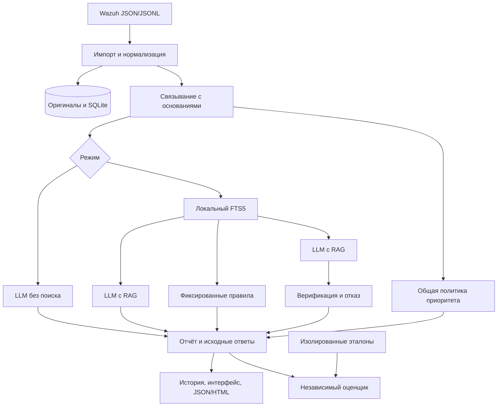

# Архитектура и решения

## Поток

## Модули

`ingest.py`: UTF-8, JSON/JSONL, границы, идентификаторы, происхождение и сущности.
`correlate.py`: детерминированные правила, известное UTC-время, окно от первого события.
`retrieval.py`: STIX, FTS5, BM25 (вес title=6), хеши и версии. При top_k=k сначала выбираются до max(1,k−1) определений, затем контекст; свободные места заполняются определениями. Один фрагмент на документ, отозванные/устаревшие документы не индексируются. Оценки BM25 сохраняются без переименования в уверенность.
`generation.py`: протокол рантайма, единственная CPU-модель, ограниченный JSON-ответ.
`profiles.py`: три профиля наблюдаемого поведения.
`verification.py`: независимая от LLM проверка ссылок, значений и достаточности.
`priority.py`: очередность проверки по наблюдаемым признакам и локальному справочнику.
`service.py`: единый конвейер, статусы, длительности, ресурсы, блокировка и сохранение.
`storage.py`: SQLite, неизменяемые исходники по SHA-256, отчёты с попытками.
`evaluation.py`: общий оценщик результатов, не импортирует верификатор/профили.
`ui.py`, `cli.py`, `export.py`: локальный интерфейс, воспроизводимые команды и экранированный экспорт.
`prepare.py`: единственный модуль получения удалённых ресурсов; не вызывается конвейером анализа.

## Хранение

- `data/originals/<sha256>.jsonl`: байты исходного файла; расширение не определяет реальный формат.
- `data/history.sqlite`: импорты с результатами проверки, случаи, все запуски и попытки генерации.
- `data/knowledge.sqlite`: отдельная база поиска и метаданные соответствия снимку.
- `knowledge/*.json`: справочные снимки/справочник ресурсов; `models/*.gguf`: внешняя модель.
- `evaluation/gold.json`: только экспериментальная оркестрация и оценка; UI/конвейер не читают.

Стабильный event_id — SHA-256 канонического JSON (первые 24 hex, префикс).
Одинаковые записи учитываются при импорте как повторы и сворачиваются при подготовке случаев.
Происхождение каждого принятого в импорте вхождения сохраняется в результате импорта.
Связь для анализа использует представителя идентичного события; все вхождения доступны в аудите импорта.
Case ID зависит от event_id и происхождения (SHA-256 файла, имя и позиция представителя). Это предотвращает подмену происхождения старого отчёта при импорте идентичного события из другого файла. Дублирование записи не создаёт искусственное подтверждение.

## Ресурсы и воспроизводимость

Нет эмбеддингов и второй модели. FTS выбран из-за предсказуемого потребления памяти.
Смена модели/лимитов не требует изменения бизнес-логики. Версии, параметры, seed,
хеши входных файлов, случая, снимка, модели и индекса входят в отчёт.
Seed не гарантирует побитовую повторяемость разных сборок и процессоров.
OS-блокировка ограничивает анализ одним процессом на хранилище и снимается после аварии.
Параллельная загрузка новой LLM из UI запрещена этой же блокировкой.
Эксперименты не должны использовать другое data-хранилище для обхода ограничения.

Версия приложения 0.1.0; формальная миграция схемы БД пока не реализована.
При будущих несовместимых изменениях потребуется явная миграция/новая база с сохранением архива.

На Linux эффективное число потоков ограничивается cgroup CPU quota и записывается в metadata.
Это предотвращает избыточную конкуренцию потоков на ограниченном стенде. На Windows используется
настроенное число потоков в пределах os.cpu_count. Конфигурация задаёт верхний предел.
Измеряется максимум RSS с периодом 0.1 с; короткие пики между измерениями могут быть пропущены.
В контейнере дополнительно сохраняются наблюдаемые CPU/memory cgroup-пределы, поскольку
psutil может показывать объём памяти хоста. Эти измерения не заменяют проверку Windows 16 ГБ.

Перед генерацией адаптер считает токены фактическим токенизатором модели и резервирует весь
лимит ответа плюс запас chat template. Если вход не помещается, удаляются последние RAG-фрагменты,
пока он не поместится; события не обрезаются. В отчёте остаются полная выдача, использованные
и исключённые chunk_id с причиной. B и D используют одну процедуру. Если не помещаются сами
события, возвращается input_budget, а не содержательный отказ. C использует полную выдачу,
поскольку ограничение генеративного контекста на него не распространяется.

После инженерной настройки ограничена схема краткой сводки: 4 факта, 3 техники,
до 4 полей доказательства на технику, 2 рекомендации. Это соответствует узкому набору профилей
и бюджету ответа CPU-модели; лимит явно указан в отчёте. Полные события/таймлайн сохраняются.
Непопадание факта в сводку не означает его отсутствия. Режим C выбирает по одному
представительному набору доказательств на технику, избегая повторов одного поведения.

Грамматика компилируется явно через LlamaGrammar.from_json_schema и передаётся параметром grammar.
Скрытый fallback llama-cpp-python к общему JSON не используется. Совместимость грамматики входит
в ready --require-llm. Regex техники записан в поддерживаемом подмножестве синтаксиса конвертера.
Ошибка компиляции даёт schema_grammar_unsupported, а не неограниченную генерацию.

Временная линия первой версии строится по Wazuh timestamp. Это время предупреждения;
время исходного действия может находиться в других полях и отличаться. Исходные поля сохраняются,
а порядок при неизвестном смещении или одинаковых метках не утверждается.

JSONL читается построчно; записи сверх max_events подсчитываются без разбора.
Отклонения по лимиту объединяются в ImportIssue.count, сохраняя точное число,
а ошибки файла отделены от числа отклонённых записей. Быстрые тесты используют
собственную временную конфигурацию, не производственные пути или модель.
